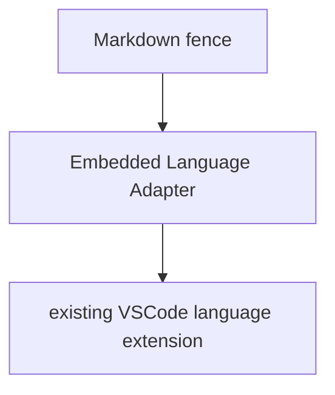
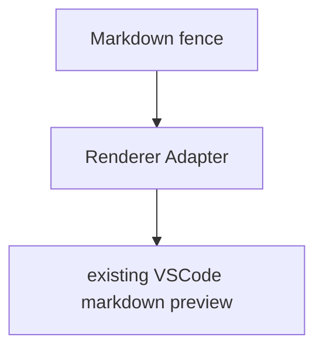

# Markdown Embedded Languages

一个声明式的 Markdown 嵌入语言适配器。

## 功能

扩展包含两个主要功能：语言服务转发和自定义渲染。

扩展为了开箱即用，会提供默认设置并捆绑一些文件。但所有设置都可以被覆盖，并且可以声明式地添加任意新语言的适配。

### 语言服务转发

使用语言服务转发，要求

- 已安装能够提供对应语言服务的扩展。本扩展会适配补全、悬停等功能。
- 准备一个对应语法的 TextMate 文件。本扩展会内置部分语言的语法文件。

设置示例

```json
{
  "markdownEmbeddedLanguages.languages": {
    "tikz": {
      "language": "latex",
      "highlight": {
        "grammar": "./grammars/tikz.tmLanguage.json"
      }
    }
  }
}
```

扩展只实现语言服务的适配。整体架构为



### 自定义渲染

使用自定义渲染，要求

- 准备一个模板文件，可以用 `{{content}}` 作为代码块内容的占位符。
- 准备一个可以对图表进行渲染的 JavaScript 文件。本扩展会内置部分渲染文件。
- 准备一个用于修改样式的 CSS 文件。本扩展会内置部分样式文件。

设置示例

```json
{
  "markdownEmbeddedLanguages.languages": {
    "tikz": {
      "language": "latex",
      "template": "./templates/tikz.tex",
      "preview": {
        "script": "./previews/tikz.js",
        "style": "./previews/tikz.css"
      },
    }
  }
}
```

扩展只实现渲染的适配。整体架构为



## 文档

- 实现计划 [PLAN.md](docs/PLAN.md)
- 当前进度 [STATUS.md](docs/STATUS.md)
- 开发文档 [DEV.md](docs/DEV.md)
